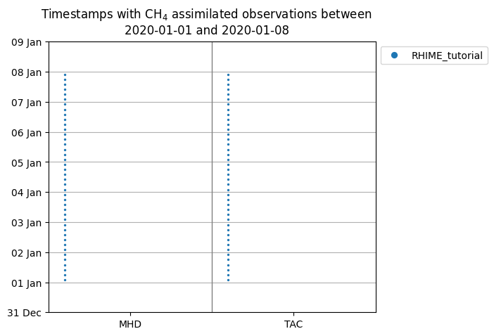
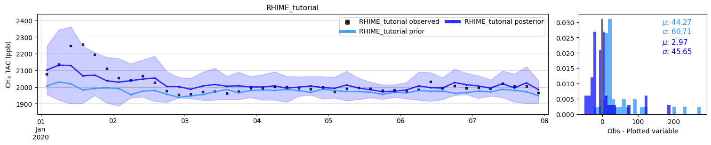
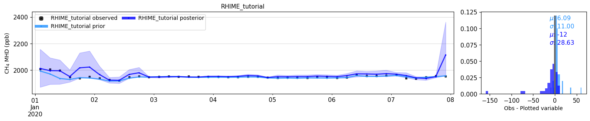
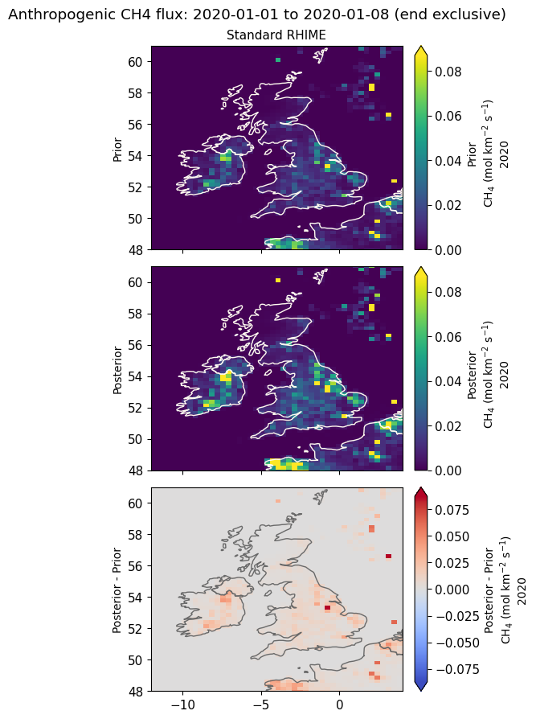

Plot a standard RHIME inversion with Fluxie
===========================================

This tutorial extends :doc:`rhime_standard_tutorial` with plots of observation
coverage, modelled and observed concentrations, residuals, and gridded fluxes.
It uses `Fluxie <https://github.com/openghg/fluxie>`_, the Flux Intercomparison
Environment, to ask two different questions: how does the model reproduce the
measurements, and how did the inferred surface flux change from its prior?

The code forms one stateful session. You can
:jupyter-download-notebook:`download it as a Jupyter notebook <rhime_standard_plotting_tutorial>`
to rerun locally. The page includes recorded figures; rerun the downloaded
notebook to display them there. Ordinary documentation builds render these
outputs without acquiring data or running an inversion.

Prerequisites
-------------

Use a source checkout and complete the installation and companion-store setup
in :doc:`rhime_standard_tutorial`. Return to the OpenGHG Inversions checkout
root after populating the store. This tutorial uses the same January 1--8,
2020 CH₄ example, with Mace Head (``MHD``) and Tacolneston (``TAC``) averaged
to four hours, and EDGAR anthropogenic prior flux.

Install Fluxie in the Python environment used by your notebook kernel. The
examples use the API at `Fluxie commit 3e67b4f
<https://github.com/openghg/fluxie/tree/3e67b4f229a191cba6ad5f73688c01de3f806e1a>`_
(including its October 2026 fixes for timestamps within a day). From the
OpenGHG Inversions checkout root, create a writable sibling checkout and
install it:

.. code-block:: console

   $ git clone https://github.com/openghg/fluxie.git ../fluxie
   $ git -C ../fluxie checkout 3e67b4f229a191cba6ad5f73688c01de3f806e1a
   $ python -m pip install -e ../fluxie

For the Pixi development environment, prefix the final command with
``pixi run -e dev`` and select that environment's notebook kernel. Fluxie
installs its plotting dependencies, including GeoPandas. It is an optional
tool, rather than an OpenGHG Inversions runtime dependency.

The map's first use downloads Natural Earth country boundaries into
``../fluxie/data/ne_data``. That first use needs internet access and a writable
Fluxie checkout; retain the downloaded cache for subsequent offline use.
This display layer is separate from the raster country mask used for PARIS
export below. We use ``tests/data/country_EUROPE.nc`` from the OpenGHG
Inversions source checkout, which matches this tutorial's native flux grid.
For another domain or grid, supply a corresponding country mask.

.. jupyter-kernel:: python3
   :id: rhime_standard_plotting_tutorial

Run the standard example
------------------------

Run the packaged configuration and retain its scientific result. Outputs go
to ``outputs`` locally; the optional environment variables allow the output
recorder to isolate files and record the source revision and data version.

.. jupyter-input::

   from importlib.metadata import version
   from importlib.resources import as_file, files
   import os
   from pathlib import Path

   import arviz as az
   import matplotlib.dates as mdates
   import matplotlib.pyplot as plt
   import xarray as xr

   import openghg_inversions
   from openghg_inversions.rhime import run_standard

   output_path = Path(os.environ.get("OPENGHG_TUTORIAL_OUTPUT_PATH", "outputs"))
   resource = files("openghg_inversions.rhime").joinpath("config/standard_tutorial.ini")
   with as_file(resource) as config_file:
       result = run_standard(config_file=config_file, output_path=output_path)

   {
       "OpenGHG Inversions commit": os.environ.get("OPENGHG_TUTORIAL_CODE_REF", "local checkout"),
       "tutorial data": os.environ.get("OPENGHG_TUTORIAL_DATA_TAG", "v1.0.0"),
       "Fluxie": version("fluxie"),
       "sites": result.site_names.values.tolist(),
       "observations": result.inv_inputs.sizes["nmeasure"],
   }

.. jupyter-output::

   {'OpenGHG Inversions commit': '8a1dbf089b01b4f51797e880a82c5eefabe1637d',
    'tutorial data': 'v1.0.0',
    'Fluxie': '2.2.1.post10.dev0+3e67b4f',
    'sites': ['MHD', 'TAC'],
    'observations': 84}

If you have already run the standard tutorial, you can instead load its saved
file with ``result = InversionOutput.load(output_path / "standard_tutorial2020-01-01_inversion_output.nc")``
after importing ``InversionOutput`` from
``openghg_inversions.postprocessing.inversion_output``. This avoids sampling
again and retains the basis, inputs, trace, and metadata required below.

Check sampling before looking at a fit
--------------------------------------

The example uses two chains with only 50 tuning and 50 retained draws each.
Inspect its diagnostics before interpreting colours or apparently close
agreement with observations:

.. jupyter-input::

   diagnostic_posterior = result.trace.posterior.to_dataset().reset_index("bc_region", drop=True)
   diagnostics = az.summary(diagnostic_posterior, var_names=["x", "bc", "sigma"], kind="diagnostics")
   diagnostics["divergences"] = int(result.trace.sample_stats["diverging"].sum())
   diagnostics.round(2)

.. jupyter-output::

                 ess_bulk ess_tail r_hat mcse_mean  mcse_sd divergences
   x[0]                 3       12  2.29     0.037    0.013           0
   x[1]                 2        5  2.48      0.23    0.013           0
   x[2]                 2        5  2.67      0.54    0.052           0
   x[3]                 2        8  2.13      0.15    0.046           0
   bc[0]                2        5  2.23      0.18    0.071           0
   bc[1]               10       37  1.76     0.014     0.02           0
   bc[2]                3        5  1.91      0.17    0.019           0
   bc[3]                2        5  2.17    0.0017  0.00066           0
   sigma[MHD, 0]        2        5  2.69      0.19    0.033           0
   sigma[TAC, 0]        3        5  2.78      0.16    0.099           0

The diagnostic view uses a plain boundary-region index for compatibility with
ArviZ's tabular summary; this leaves the result's labelled coordinates intact.

This short run demonstrates the workflow. Its posterior summaries are not
adequate scientific estimates. A longer run needs acceptable R-hat, effective
sample sizes, trace behaviour, and divergence diagnostics; a close fit alone
does not establish those conditions. See the :ref:`standard tutorial diagnostic
workflow <standard-rhime-diagnostics>` and :doc:`running_and_validating`.

Prepare products for plotting
-----------------------------

``InversionOutput`` is the durable scientific result. Fluxie consumes
dictionaries of labelled xarray datasets in the PARIS reporting schema.
Use the supported PARIS export to calculate summaries from the retained
chains, then let Fluxie normalise the reporting metadata and select units.
This also avoids manually reconstructing flux fields from region scalings.

.. jupyter-input::

   from fluxie.io import edit_vars_and_attributes, read_config_files
   from fluxie.operators.select import slice_flux, slice_mf
   from openghg_inversions.postprocessing.make_paris_outputs import make_paris_outputs

   checkout = Path(openghg_inversions.__file__).resolve().parents[1]
   country_file = checkout / "tests/data/country_EUROPE.nc"
   flux_product, concentration_product = make_paris_outputs(
       result,
       country_file=country_file,
       template_version="latest",
       country_selections=["GBR", "IRL", "FRA"],
       obs_avg_period="4h",
       flux_frequency="yearly",
       inversion_grid=False,
   )

   config = read_config_files()
   experiment = "RHIME_tutorial"
   flux = edit_vars_and_attributes(
       xr.decode_cf(flux_product), experiment, "yearly", "flux",
       config["regions_info"], config["site_info"], species="ch4",
   )
   concentration = edit_vars_and_attributes(
       xr.decode_cf(concentration_product), experiment, "yearly", "concentration",
       config["regions_info"], config["site_info"], species="ch4",
   )
   concentrations = {experiment: concentration}
   start_date, end_date = result.start_date, result.end_date
   fluxes = slice_flux(
       {experiment: flux}, config, start_date, end_date, species="ch4",
       flux_units_print="mol km-2 s-1", country_flux_units_print="Tg yr-1",
   )
   "Prepared PARIS products and Fluxie plotting datasets."

.. jupyter-output::

   'Prepared PARIS products and Fluxie plotting datasets.'

``xr.decode_cf`` converts the export's numeric CF time coordinates into
datetimes. Reopening a written PARIS file with ``xr.open_dataset`` performs
that decoding automatically. ``edit_vars_and_attributes`` adds Fluxie's
experiment and frequency metadata. It operates on the derived plotting
products, so the retained scientific result remains available for other
postprocessing.

The supplied EDGAR prior is an annual 2020 field, even though the inversion
covers only a week. ``flux_frequency="yearly"`` preserves that support; the export
clips its time bounds to January 1--8. The map therefore contains one period.
``country_selections`` limits the exported country totals, not the geographical
extent of its gridded flux fields. We will plot a smaller region of that grid.

Check which measurements are present
------------------------------------

Start with observation coverage. Otherwise a gap in the following time series
could be mistaken for a model feature:

.. jupyter-input::

   from fluxie.plots.mf_timeseries import plot_mf_timeseries, plot_sites_timeseries

   coverage_figure = plot_sites_timeseries(
       concentrations, "mf_observed", species="ch4", config_data=config,
       start_date=start_date, end_date=end_date,
   )
   coverage_figure.set_size_inches(6, 5)
   coverage_figure.axes[0].yaxis.set_major_locator(mdates.DayLocator())
   coverage_figure.axes[0].yaxis.set_major_formatter(mdates.DateFormatter("%d %b"))
   plt.show()
   "Observation availability at MHD and TAC."

.. jupyter-output::

   'Observation availability at MHD and TAC.'

   Availability of the retained four-hour observations at MHD and TAC. This
   plot shows temporal coverage; it does not measure transport sensitivity or
   the strength of a station's constraint on emissions.

Compare concentrations at Tacolneston
-------------------------------------

Select one station using its label and request parts per billion (ppb).
The prior and posterior lines are means of saved predictive concentrations,
including the surface-flux and boundary contributions. They can be compared
with the observed total mole fraction on the same scale:

.. jupyter-input::

   tac = slice_mf(
       {experiment: concentration.copy(deep=True)}, start_date, end_date,
       site="TAC", mf_units_print="ppb",
   )
   tac_figure = plot_mf_timeseries(
       tac, species="ch4", site="TAC", config_data=config,
       include={
           "mf_observed": None,
           "mf_prior": None,
           "mf_posterior": "percentile_mf_posterior",
       },
       diff_include=["mf_prior", "mf_posterior"],
   )
   plt.show()
   "TAC observed and modelled mole fractions, with residual distributions."

.. jupyter-output::

   'TAC observed and modelled mole fractions, with residual distributions.'

   Four-hour CH₄ mole fractions at TAC, in ppb, with the exported posterior
   percentile band and distributions of observation-minus-model residuals.
   These are summaries from the short demonstration run.

Look for the timing and size of enhancements as well as the overall level.
The residual histogram summarises observation minus model: positive residuals
mean the observed mole fraction is higher. A distribution closer to zero
suggests less average mismatch over these retained observations; it does not
show when the mismatch occurred. Use the time series alongside it.

The shaded band spans the 15.9th--84.1st percentiles of saved
posterior-predictive concentration draws at the retained observation
locations. For this standard recipe, those draws include the configured
observation-model uncertainty as well as sampled parameter uncertainty.
The band is not an uncertainty interval for emissions, and the fitted
observations are not independent validation. See :doc:`prior_predictive_checking`
for checks using samples from the complete observation model.

We copy the derived dataset before ``slice_mf`` because Fluxie's unit selection
can update dataset contents. Keeping a separate plotting copy lets us select
another site or unit without changing the shared concentration product.

Repeat the comparison at Mace Head
----------------------------------

Use the same variables and units at the second station. An apparent
improvement at one station may coexist with a persistent mismatch at another:

.. jupyter-input::

   mhd = slice_mf(
       {experiment: concentration.copy(deep=True)}, start_date, end_date,
       site="MHD", mf_units_print="ppb",
   )
   mhd_figure = plot_mf_timeseries(
       mhd, species="ch4", site="MHD", config_data=config,
       include={
           "mf_observed": None,
           "mf_prior": None,
           "mf_posterior": "percentile_mf_posterior",
       },
       diff_include=["mf_prior", "mf_posterior"],
   )
   plt.show()
   "MHD observed and modelled mole fractions, with residual distributions."

.. jupyter-output::

   'MHD observed and modelled mole fractions, with residual distributions.'

   The corresponding comparison at MHD. Compare timing, levels, residuals,
   and uncertainty at each site before attributing a change to surface flux.

The standard recipe also adjusts boundary-condition scalings. Consequently,
a change in modelled concentration cannot be attributed wholly to a change in
local emissions. Concentration plots evaluate the combined model at the
measurement locations; the next plot shows its surface-flux result.

Map the prior, posterior, and their difference
----------------------------------------------

Fluxie's basic flux map displays three panels: prior, posterior, and posterior
minus prior. Set the geographical bounds explicitly, in the order west, east,
south, north:

.. jupyter-input::

   from fluxie.plots.flux_map import plot_flux_map

   flux_figure = plot_flux_map(
       fluxes, "ch4", region=[-12, 4, 48, 61], config_data=config,
       model_labels={experiment: "Standard RHIME"}, add_sites=False,
   )
   flux_figure.suptitle(f"Anthropogenic CH4 flux: {start_date} to {end_date} (end exclusive)")
   plt.show()
   "Prior and posterior anthropogenic CH4 flux, and posterior minus prior."

.. jupyter-output::

   'Prior and posterior anthropogenic CH4 flux, and posterior minus prior.'

   Gridded flux density in mol km⁻² s⁻¹ from January 1 inclusive to January 8,
   2020 exclusive.
   Positive differences mean increased flux relative to the prior;
   negative differences mean decreased flux. The difference panel has its
   own colour scale.

The units now describe an amount emitted per area per time, rather than a
concentration. A flux-density map is also distinct from a country total,
which integrates over cell areas. The prior and posterior panels share a
colour scale; use the difference panel's colour bar to interpret changes.

This example estimates only four regional multiplicative scalings. Fine
spatial detail in the posterior map comes from the prior inventory within
those regions; displaying the native grid does not establish that each cell
was independently constrained. Likewise, a large change is not a map of
statistical significance or uncertainty. Interpret these demonstration maps
only after replacing the short run with a scientifically adequate inversion.

Save the figures and continue
-----------------------------

Each plotting call returns a Matplotlib figure. Keep those objects to save
exactly the plots you inspected:

.. jupyter-input::

   figure_directory = output_path / "figures"
   figure_directory.mkdir(parents=True, exist_ok=True)
   coverage_figure.savefig(figure_directory / "observation-coverage.png", dpi=150, bbox_inches="tight")
   tac_figure.savefig(figure_directory / "tac-concentrations.png", dpi=150, bbox_inches="tight")
   mhd_figure.savefig(figure_directory / "mhd-concentrations.png", dpi=150, bbox_inches="tight")
   flux_figure.savefig(figure_directory / "anthropogenic-flux.png", dpi=150, bbox_inches="tight")
   "Saved four PNG figures under the run's figures directory."

.. jupyter-output::

   "Saved four PNG figures under the run's figures directory."

For a full-month example, change the inversion's end date as described in the
standard tutorial and repeat the same steps. Fluxie also provides country
flux time series and comparisons between experiments; see its
`basic examples <https://github.com/openghg/fluxie/blob/3e67b4f229a191cba6ad5f73688c01de3f806e1a/scripts/example_basics.ipynb>`_.
A single inversion here supplies one flux timestamp, so it cannot demonstrate
a temporal trend in country emissions. Use multiple reporting periods for
that comparison, and retain their time bounds and units.

Maintainers can refresh this page's outputs and figures with the
:doc:`standard tutorial's output recorder <rhime_standard_tutorial>` after
installing Fluxie in the recording environment:

.. code-block:: console

   $ pixi run -e dev python -m scripts.record_tutorial_outputs --tutorial rhime_standard_plotting_tutorial

The recorder uses the pinned companion data and a clean tracked checkout.
Review the diagnostic table and figures when recording a new dependency
version; numerical results and sampler diagnostics can change.
